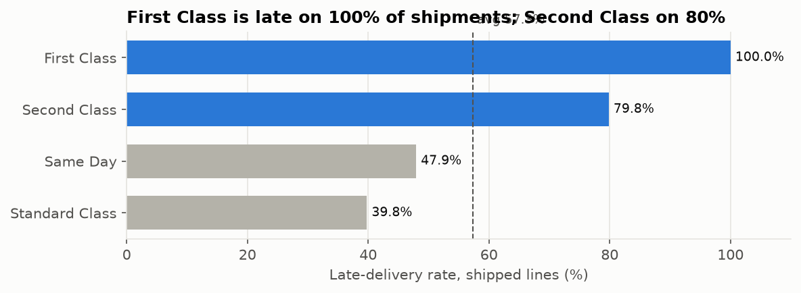
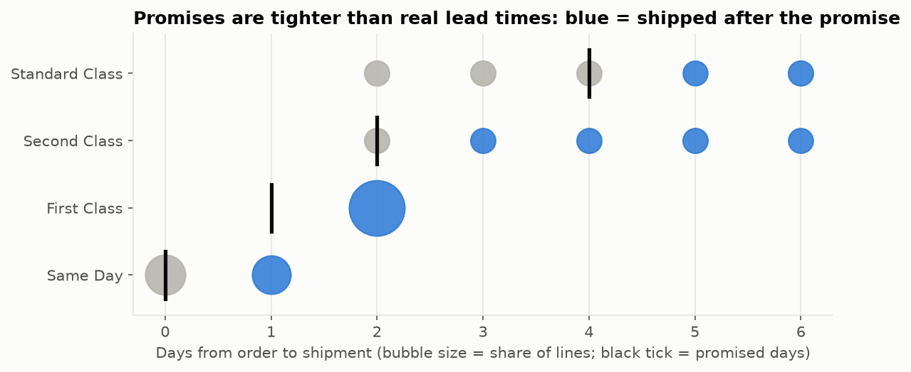
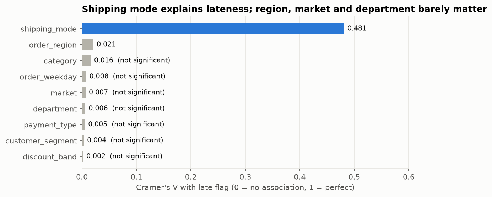
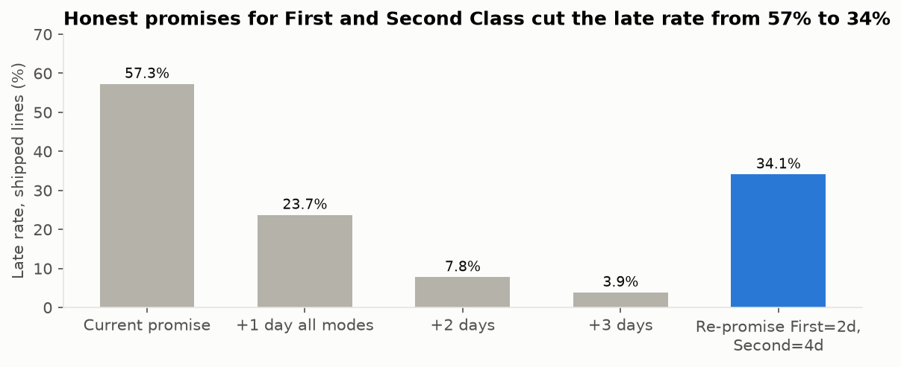

# Supply Chain Late-Delivery Risk Dashboard

**Python (Pandas, SciPy, scikit-learn) · Tableau**

57.3% of DataCo's shipped orders arrive late. This project finds out why and what to change.
**Short answer: the shipping-mode delivery promises are wrong. Regions and departments are not the cause.**

Live dashboard: _add your Tableau Public link here_

## Key findings

| # | Finding | Evidence |
|---|---|---|
| 1 | **First Class is late 100% of the time.** It promises 1 day and always takes exactly 2 | 26,513 of 26,513 shipped First Class lines are late |
| 2 | **Second Class is late 80% of the time.** It promises 2 days; real time is spread evenly over 2–6 days | Average 2.0 days late |
| 3 | **Shipping mode is the only strong driver** | Cramér's V: mode 0.48, region 0.02. Market, department, category and segment are not significant (p > 0.05) |
| 4 | Region adds almost nothing on top of mode | Logistic regression AUC: mode only 0.743, region + market + department + segment 0.506 (≈ coin flip), all features 0.745 |
| 5 | Lateness is **flat at 55–59% every month** for 33 months | A structural problem, not a seasonal one |
| 6 | Late lines are **not** meaningfully less profitable | $21.62 vs $22.58 profit per line, Welch t-test p = 0.057 |
| 7 | **The real profit leak is loss-making lines:** 18.7% of lines lose money | $3.88M of losses wipe out 49% of the $7.85M gross profit, at the same rate in every mode, region and discount band |
| 8 | **Fix:** promise First Class at 2 days and Second Class at 4 | Late rate 57.3% → 34.1%. A +1 day buffer on all modes → 23.7% |






## Recommendations

1. **Re-promise First Class at 2 days now.** It is a config change, and it removes 26.5k late lines, 27% of all late lines.
2. **Fix Second Class lead-time variance.** It ships in anywhere from 2 to 6 days, so no promise can be both tight and reliable. Audit carrier or warehouse hand-offs; until then, promise 4 days.
3. **Stop chasing regional fixes.** Every region is within 6 points of the average. Regional programmes would spend money on noise.
4. **Track late rate on shipped lines only.** Canceled lines inflate on-time performance by 2.5 points.
5. **Open a separate pricing review.** 18.7% of lines lose money regardless of delivery. That is a margin problem, not a logistics one.

## Project structure

```
supply_chain_project/
├── data/
│   ├── raw/                  DataCo CSVs (downloaded, git-ignored)
│   └── processed/            order_lines_clean.csv (git-ignored)
├── src/
│   ├── config.py             paths, column renames, drop list, country translation
│   ├── download_data.py      step 0: fetch dataset from Kaggle
│   ├── clean.py              step 1: validate, clean, engineer features
│   ├── analysis.py           step 2: KPIs, drivers, stats tests, what-if → CSV tables
│   ├── charts.py             step 3: PNG charts for this README
│   ├── export_tableau.py     step 4: Tableau-ready extract
│   └── run_pipeline.py       runs steps 0–4
├── outputs/
│   ├── tables/               00–17 result tables (CSV)
│   └── charts/               01–07 PNG charts
├── tableau/
│   ├── DASHBOARD_BUILD_GUIDE.md   calculated fields, parameters, sheets, actions
│   └── tableau_order_lines.csv    extract (generated, git-ignored)
└── requirements.txt
```

## Run it

```bash
python -m venv .venv && .venv\Scripts\activate      # Windows
pip install -r requirements.txt
python src/run_pipeline.py                          # ~1 minute
```

Then follow `tableau/DASHBOARD_BUILD_GUIDE.md`.

## Data

[DataCo Smart Supply Chain dataset](https://www.kaggle.com/datasets/shashwatwork/dataco-smart-supply-chain-for-big-data-analysis)
(Kaggle, CC BY 4.0). 180,519 order lines, 65,752 orders, Jan 2015 – Jan 2018. Monthly trends use Jan 2015 – Sep 2017,
because from Oct 2017 the data has a different shape (1 line per order, fewer categories).

## Method notes

- **Grain:** one row = one order line. Each order has a single shipping mode, region and delivery status (verified).
- **Late rate denominator:** shipped lines only. The 7,754 canceled lines carry late flag 0 and would otherwise dilute the rate (54.8% → 57.3%).
- **13 data-quality checks** run before analysis (`outputs/tables/00_data_quality_checks.csv`).
- **Driver strength:** chi-square test of independence and Cramér's V per dimension, cross-checked with a logistic regression (70/30 split, AUC).
- **Limitation:** the dataset is synthetic (uniform lead-time distributions), so the findings are about method, not about a real company.
